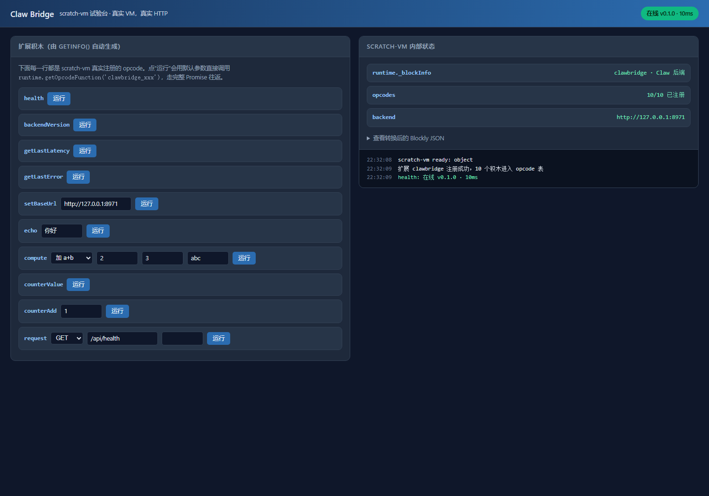

# Claw Bridge

Scratch 3 扩展 + Rust 后端的最小可跑样板。积木在 Scratch 里，计算和状态在 Rust 服务里，
一条 HTTP 往返把两边连起来。整条链路都在本地跑，离线可用——不依赖任何在线 CDN。

```
                    ┌──────────────────────────────────────────────────┐
                    │  extension/claw-bridge/index.js                  │
                    │  Scratch 3 扩展 · id: clawbridge · 10 个积木     │
                    │  每个积木 = 一次 HTTP 请求，返回 Promise         │
                    └───────────────────┬──────────────────────────────┘
                                        │  HTTP/1.1 + JSON
                                        │  127.0.0.1:8971 · CORS: *
                                        ▼
                    ┌──────────────────────────────────────────────────┐
                    │  backend/  (Rust, axum 0.7 + tokio)              │
                    │  GET  /api/health      POST /api/echo            │
                    │  POST /api/compute     GET|POST /api/counter     │
                    │  GET  /serve/*path     GET /  → 内置试验台       │
                    │  evaluate() 纯函数，11 个单元测试覆盖            │
                    └───────────────────┬──────────────────────────────┘
                                        │ 同一个后端顺带当静态服务器
                                        ▼
                    ┌──────────────────────────────────────────────────┐
                    │  web/index.html  (浏览器试验台)                  │
                    │  从 /serve/.../scratch-vm.js 加载 VM             │
                    │  _registerInternalExtension 注入扩展             │
                    │  ?autorun=1 → 自动跑 10 个积木                   │
                    └──────────────────────────────────────────────────┘

两条加载路径：
  · 进程内注入（试验台 / node 测试）── 正常，无需补丁
  · loadExtensionURL → Worker（真实编辑器）── 需先打补丁
```

## 快速开始

```bash
# 0. 一次性准备：装 scratch-vm（试验台和 node 测试都要用它）
cmd /c "npm install --prefix harness --cache harness\.npmcache --registry https://registry.npmmirror.com scratch-vm@5.0.300 --no-audit --no-fund"
node scripts/patch-scratch-vm.mjs

# 1. 构建后端（必须先杀掉正在跑的 claw-backend.exe，否则 exe 被占用会报 os error 5）
cd backend && cargo build --offline --release && cd ..

# 2. 启动后端（默认 127.0.0.1:8971，前台运行）
./backend/target/release/claw-backend.exe

# 3. 浏览器打开试验台
#    http://127.0.0.1:8971/

# 4. 一键跑全部测试（另外开一个终端）
node scripts/run-all.mjs
```

注意 `--offline`：这台机器上 cargo 联网必定失败（`schannel: SEC_E_NO_CREDENTIALS`），
靠本地 registry 缓存编。`npm` 必须走镜像且用 `cmd /c` 调用（`npm.ps1` 被执行策略挡住）。
原因和其余环境坑见「环境限制」。

后端同时也是静态服务器，所以 `http://127.0.0.1:8971/` 直接就是试验台页面：



每一行都是从 `getInfo()` 自动生成的——加一个积木不用改页面。点「运行」会用默认参数
直接调用 `runtime.getOpcodeFunction('clawbridge_xxx')`，走完整的 Promise 往返。
带 `?autorun=1` 会一进来就把 10 个积木顺序跑一遍，跑完在页面上写 `10 成功 / 0 失败`
（无头验证就是读这个入口，见「测试与验证」）。

## 目录

```
backend/          Rust 后端（axum 0.7 + tokio）
  src/main.rs     全部逻辑，含 11 个单元测试
extension/
  claw-bridge/    扩展本体（index.js，一份代码三处用）
web/
  index.html          试验台：自动生成每个积木的运行按钮
  worker-test.html    走真实 Worker 加载路径的验证页
  extension-worker.js 从 scratch-vm dist 复制（Worker 相对路径要求）
harness/          npm 装的 scratch-vm
scripts/
  run-all.mjs           一键跑全部测试
  smoke-backend.mjs     HTTP 端到端（76 项）
  smoke-extension.cjs   headless scratch-vm（34 项）
  patch-scratch-vm.mjs  修上游 Worker 缺陷（重要，见下）
  cdp-probe.mjs         用 CDP 驱动 headless Edge 验证页面
  cdp-eval.mjs          同上，求值任意表达式
docs/
  PROTOCOL.md             HTTP 契约
  BUG-worker-dispatch.md  上游缺陷记录
```

## 积木

扩展 id 是 `clawbridge`，所以 opcode 一律是 `clawbridge_<块名>`（`extension/claw-bridge/index.js`）：

| 积木 | opcode | 作用 |
|---|---|---|
| `health` | `clawbridge_health` | 后端是否在线（`在线 v0.1.0 · 3ms` / `离线`） |
| `backendVersion` | `clawbridge_backendVersion` | 后端版本号 |
| `getLastLatency` | `clawbridge_getLastLatency` | 上次请求耗时（ms） |
| `getLastError` | `clawbridge_getLastError` | 上次错误信息 |
| `setBaseUrl` | `clawbridge_setBaseUrl` | 设置后端地址 |
| `echo` | `clawbridge_echo` | 原样回显，验证 unicode 往返 |
| `compute` | `clawbridge_compute` | 在服务端计算（op 见下表） |
| `counterValue` | `clawbridge_counterValue` | 读后端计数器 |
| `counterAdd` | `clawbridge_counterAdd` | 计数器加 delta（默认 1） |
| `request` | `clawbridge_request` | 通用 HTTP 调用，返回 JSON 字符串 |

`getInfo().blocks` 里还有 4 个 `'---'` 分隔符，所以 `runtime._blockInfo` 里是 **14 项 = 10 个真积木 + 4 个分隔符**。
（`getLastLatency` / `getLastError` 特意没有和内部的 `lastLatency` / `lastError` 同名——
同名会被实例属性遮住原型方法，积木直接调不到。）

积木方法返回 Promise，scratch-vm 会真的把线程挂起等 HTTP 回来
（`thread.status = STATUS_PROMISE_WAIT`），不是同步假装的。网络失败时**不抛异常**，
返回 `''` / `false` / `0`，错误留在 `getLastError` 里。

## `/api/compute` 的 op

`POST /api/compute` 收 `{op, a, b, text}`（`a`/`b`/`text` 都有默认值，可只传用得到的），
实现对 `backend/src/main.rs` 的 `evaluate()`：

| op | 输入 | 结果 | 备注 |
|---|---|---|---|
| `add` | a, b | 数 | `a + b` |
| `sub` | a, b | 数 | `a - b` |
| `mul` | a, b | 数 | `a * b` |
| `div` | a, b | 数 | `b == 0` → HTTP 400 `division by zero` |
| `pow` | a, b | 数 | `a.powf(b)` |
| `sqrt` | a | 数 | `a < 0` → HTTP 400 `sqrt of negative number` |
| `sha1` | text | 字符串 | 40 位小写十六进制 |
| `reverse` | text | 字符串 | 按 Unicode 字符反转（不是按字节） |
| `wordcount` | text | 数 | `split_whitespace` 的词数 |
| `prime` | a | 布尔 | 负数/非整数 → HTTP 400 |
| `fib` | a | 数 | `0 ≤ a ≤ 90`，越界 → HTTP 400（`u64` 不溢出） |

未知 op → HTTP 400 `{"ok":false,"error":"unknown op: <op>"}`。错误响应都是
HTTP 400 + `{"ok":false,"error":"…"}`，扩展把 `error` 抄进 `lastError`。

## 三种加载路径

同一份 `extension/claw-bridge/index.js` 支持三种用法：

| 路径 | 怎么用 | 状态 |
|---|---|---|
| **试验台**（先看这个） | 开 `http://127.0.0.1:8971/`，点积木行的「运行」 | ✅ 10/10 |
| **headless 测试** | `vm.extensionManager._registerInternalExtension(ext)` | ✅ 34/34 |
| **真实编辑器**（TurboWarp / Scratch GUI） | `vm.extensionManager.loadExtensionURL(url)` → Worker | ⚠️ 需先打补丁 |

第三条是编辑器里「加载扩展」的真实走法，但 scratch-vm 5.0.300 在这个路径上有**上游缺陷**，
不修就会在第一次调积木时抛 `DataCloneError`。修法：

```bash
node scripts/patch-scratch-vm.mjs
```

根因、最小复现见 [docs/BUG-worker-dispatch.md](docs/BUG-worker-dispatch.md)。
该缺陷与本扩展无关——官方文档里的最小扩展同样复现，`scratch-vm` 的 `develop` 分支也没修。

## HTTP 接口

完整契约见 [docs/PROTOCOL.md](docs/PROTOCOL.md)，端点：

| 方法 | 路径 | 作用 |
|---|---|---|
| GET | `/api/health` | `{ok, service, version, uptime_ms, requests}` |
| POST | `/api/echo` | `{message}` → `{ok, echo, received_at_ms}` |
| POST | `/api/compute` | `{op, a, b, text}` → `{ok, result}` |
| GET | `/api/counter` | `{ok, value}` |
| POST | `/api/counter` | `{delta}` → `{ok, value}`（无 body 时 +1） |
| GET | `/` | 试验台页面 |
| GET | `/serve/*path` | 静态文件（工作区内，防目录穿越） |

所有响应带 CORS 头（`Access-Control-Allow-Origin: *`，`OPTIONS` 任意路径回 204），
所以从任意源加载的 Scratch 页面都能直接调。错误一律 HTTP 400/404/405/500 +
`{"ok":false,"error":"…"}`。

## 测试与验证

| 套件 | 数量 | 内容 |
|---|---|---|
| `cargo test --offline` | 11 | op 分派、除零、sqrt 负数、sha1 向量、unicode 反转、目录穿越 |
| `smoke-backend.mjs` | 76 | CORS、预检、畸形 JSON、13 个 compute 用例 + 5 个错误用例、计数器、静态文件、4 条穿越、404/405 |
| `smoke-extension.cjs` | 34 | 积木注册、Promise 往返、真实 VM 线程执行、后端不可达时的降级 |
| `worker-test.html`（CDP） | 9 | 打补丁后：Worker 加载 + 真实积木调用往返 |
| `index.html?autorun=1`（CDP） | 10 | 试验台把每个积木都跑一遍 |

前三个用 `node scripts/run-all.mjs` 一把跑完（它会自己起后端，跑完再收掉）；后两个需要真实 Edge：

```bash
node scripts/cdp-probe.mjs "http://127.0.0.1:8971/?autorun=1" 16000
node scripts/cdp-probe.mjs http://127.0.0.1:8971/serve/web/worker-test.html 14000
```

`cdp-probe.mjs` 是**真实等待**指定毫秒数再读结果，别换成 `--virtual-time-budget`——
虚拟时间会快进定时器，Worker 握手还没回来就误判超时。细节见 BUG 文档的「验证方式」。

## 设计取舍

**为什么用 Rust，而不是 C++。** 最初想用 C++（这台机器上装了 MinGW），但本地没有可用的 C++
包生态：没有 vcpkg/conan 的可用镜像，HTTP 服务和 JSON 全靠手写，调试成本远超收益。Rust 这边
`cargo` 的本地 registry 缓存是热的，axum + tokio + serde 直接 `--offline` 就能编。

**为什么是 HTTP 请求/响应，而不是 WebSocket。** axum 的 `ws` feature 需要 `tokio-tungstenite`，
本机离线 crate 缓存里没有这个包，也装不进来（见下面环境限制）。于是退到纯 HTTP：每个积木一次
请求，Promise 返回，scratch-vm 自动把线程挂起等结果。对本项目的用途（算数、哈希、计数器）足够了。

**为什么自带一个浏览器试验台。** 这台机器上不了国际网，打不开 Turbowarp 的在线编辑器，也拉不到
Scratch GUI 的 CDN 资源——「在真实编辑器里点一下」这条路根本走不通。所以后端顺便当静态服务器：
`GET /` 直接吐 `web/index.html`，页面从 `/serve/harness/node_modules/scratch-vm/dist/web/scratch-vm.js`
加载同一个 vm，把 `getInfo()` 里的每个积木自动渲染成一行「运行」按钮。改一个积木不用改页面。
自检也因此完全不依赖外网。

## 环境限制

这台机器上的坑都踩过一遍，照抄下面的姿势能少走弯路：

1. **`cargo` 必须 `--offline`。** 联网拉 crates 会失败（`schannel: SEC_E_NO_CREDENTIALS`）。
   所有命令都写成 `cargo build --offline --release` / `cargo test --offline`，别用裸 `cargo build`。
   依赖能编是因为本地 registry 缓存里已经有 axum/tokio/serde/sha1 等。
2. **npm 必须走镜像 + 工作区局部缓存，并且用 `cmd /c`。** 本机 `npm.ps1` 被执行策略挡住
   （`ExecutionPolicy` 全是 `Undefined`），PowerShell 里直接敲 `npm` 会红：
   ```bash
   cmd /c "npm install --prefix harness --cache harness\.npmcache --registry https://registry.npmmirror.com scratch-vm@5.0.300 --no-audit --no-fund"
   ```
3. **重新编后端前，先杀掉正在跑的 `claw-backend.exe`。** 否则 cargo 覆盖 exe 时失败，
   报 `os error 5`（拒绝访问）。看谁占着端口：`Get-Process claw-backend`。
4. **别用 `Invoke-WebRequest` 测接口。** 它在这台机器上报
   `Win32 internal error "Access is denied" 0x5`，而且 PowerShell 会把命令行里的 JSON 引号揉掉。
   用 `node` 脚本或 `curl.exe --noproxy '*'`。
5. **没有 WebSocket 的 crate 可用**（见「设计取舍」），所以协议是纯 HTTP。

## 已知问题

**真实编辑器（Scratch GUI / TurboWarp）的 Worker 路径需要先打补丁**：

```bash
node scripts/patch-scratch-vm.mjs
```

`scratch-vm@5.0.300` 在「主线程 → Worker」派发积木调用时有两个叠加的上游缺陷，不打补丁的话
第一次调积木就抛 `DataCloneError`。根因、最小复现、补丁前后对比全部记在
[docs/BUG-worker-dispatch.md](docs/BUG-worker-dispatch.md)。该缺陷与本扩展无关——官方风格的最小扩展
同样能复现，上游 `develop` 分支也没修。

**本项目的试验台和 node 测试走的是进程内注入路径，完全正常**，不需要打补丁也不受它影响：

| 路径 | 机制 | 状态 |
|---|---|---|
| 试验台 `web/index.html` | `_registerInternalExtension` | ✅ 10 成功 / 0 失败 |
| node 测试 `smoke-extension.cjs` | `_registerInternalExtension` | ✅ 34 通过 / 0 失败 |
| Worker 验证页 `web/worker-test.html` | `loadExtensionURL` → Worker | ✅ 9 通过 / 0 失败（**打补丁后**） |

也就是说：**日常开发和自检不受这个 bug 干扰**，只有真的要装进在线编辑器时才需要补丁。

其余已知限制：

- **Worker 模式下 `util` 是 `undefined`**（补丁的副作用）。本扩展不用 `util`，无影响；
  但用 `util.startBranch` / `util.yieldTick` 的积木得走进程内注入路径。
- **后端默认只监听 `127.0.0.1`**。要从别处连就设 `CLAW_HOST=0.0.0.0`（注意 CORS 是 `*`）。
- **重新 `npm install` 后要重跑 `patch-scratch-vm.mjs`**，补丁会被覆盖。
  随时用 `node scripts/patch-scratch-vm.mjs --check` 确认当前状态。

## 配置

| 环境变量 | 默认 | 作用 |
|---|---|---|
| `CLAW_HOST` | `127.0.0.1` | 监听地址 |
| `CLAW_PORT` | `8971` | 监听端口 |
| `CLAW_ROOT` | 工作区根 | 静态文件根目录 |

扩展侧地址用 `setBaseUrl` 积木改，默认 `http://127.0.0.1:8971`。
